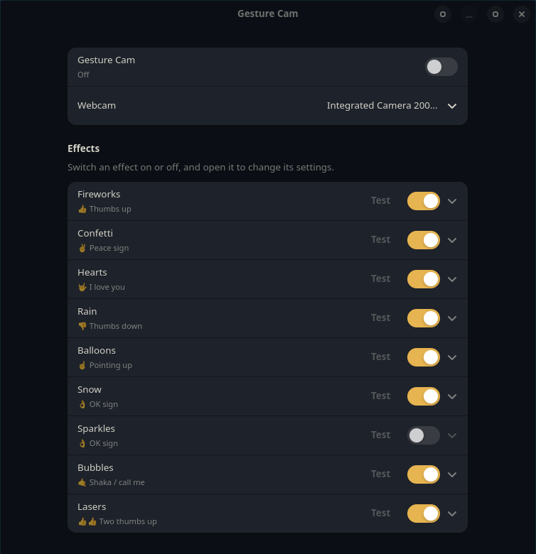

# Gesture Cam

Webcam effects for video calls and camera apps, triggered by hand gestures. The effects play behind you:
the person in the frame is cut out with MediaPipe's selfie segmenter, so they never cover your face.

Effects: fireworks, confetti, hearts, rain, balloons, snow, sparkles, bubbles and lasers.
Hold a gesture for about ⅓ s to play its effect. Which gesture plays which effect is set in the window.

The gestures to choose from are the seven that MediaPipe's model recognises, and five that Gesture Cam
works out itself:

- 👍 thumbs up, 👎 thumbs down, ✌️ peace sign, 🤟 "I love you", ☝️ pointing up, ✋ open palm and ✊ fist,
  from the model.
- 👍👍 two thumbs up, 👎👎 two thumbs down and 🙌 both hands open, from the model's result for each hand.
- 👌 OK sign and 🤙 shaka, from the finger positions. These are rule-based, so they can be less
  reliable than the model's own gestures.



## Install

Works on Arch (and Arch-based distros such as CachyOS, EndeavourOS, Manjaro), Debian 13+, Ubuntu 24.04+
and Fedora 40+. Older releases have a libadwaita or GLib that's too old for the window.

```sh
curl -fsSL https://raw.githubusercontent.com/Soulmanyes/gesture-cam/main/install.sh | sh
```

This puts the app in `~/.local/share/gesture-cam`. To keep it somewhere else, download
`gesture-cam.tar.gz` from https://szekbal.duckdns.org/apps/gesture-cam/ and unpack it, or clone this
repository, then run `install.sh` from that folder:

```sh
tar xzf gesture-cam.tar.gz && cd gesture-cam
# or
git clone https://github.com/Soulmanyes/gesture-cam.git && cd gesture-cam
./install.sh
```

Keep the folder where it is after installing: the app menu entry points into it.

The first time, `install.sh` asks for your password and runs `setup.sh` as root. That installs the
window's libraries (GTK 4, libadwaita, PyGObject), GStreamer's PipeWire plugin and v4l2loopback, then
creates the virtual camera `/dev/video10`, named "Gesture Cam". It also adds config so the camera comes
back after every reboot. On Fedora it enables the RPM Fusion (free) repository, which is where
v4l2loopback comes from. Once the camera exists, later runs skip this step.

With Secure Boot on, the driver is blocked until its signing key is enrolled. The script then prints the
`mokutil --import` command to run; after a reboot, pick "Enroll MOK" on the blue screen, then run the
install command again.

Then `install.sh` creates the Python environment in `.venv`, installs its packages, downloads
MediaPipe's two models from Google with `get-models.sh` and adds Gesture Cam to your app menu.
The models aren't included in Gesture Cam's download, so `get-models.sh` fetches them from Google
and checks them. The launcher also runs it if they're missing.

## Use

1. Make sure no other app (Discord, Vesktop, a camera app) is using your webcam. Turn your camera off there, or switch it away from the webcam.
   Gesture Cam needs the real webcam for itself.
2. Open **Gesture Cam** from your app launcher. It turns the camera on straight away.
   Keep the window open while you use it: closing it turns the camera off.
3. In Discord or Vesktop, go to Settings > Voice & Video > Camera and pick **Gesture Cam**.
   It only shows up while Gesture Cam is on. Restart Discord the first time, so it sees the new device.

Other camera apps (GNOME Snapshot, OBS's PipeWire camera source, browsers) find cameras through PipeWire
instead. Gesture Cam offers the same picture there too, also named **Gesture Cam**, while it's on.
Open the app after turning Gesture Cam on, or reopen it, so it lists the camera.

The picture is 1280×720 at 30 frames per second.

## Settings

The **Gesture Cam** switch at the top turns the camera on and off; its subtitle shows what it's doing
or what went wrong. The **Webcam** menu picks which camera to use; changing it restarts the camera.

Below that is a section for each effect:

- **Enabled**: turns the effect on or off.
- **Gesture**: which hand gesture plays it. Two effects can share a gesture, and then both play.
- **Keep going while the gesture is held**: the effect plays for as long as you hold the gesture.
  When this is off, the effect plays for **Duration** seconds instead.
- **Amount**: how much each burst has: rockets, confetti pieces, hearts, raindrops, balloons,
  snowflakes, sparkles, bubbles or laser beams.
- **Frequency**: bursts per second while the effect plays.
- **Duration**: how long the effect plays, when it doesn't keep going while held.
- **Test**: plays the effect now, without the gesture. It works while the camera is on.

Changes apply immediately and are saved to `~/.config/gesture-cam/settings.json`.

## Without the window

`./gesture-cam --headless` runs the camera without a window, using the saved settings. Stop it with Ctrl+C.

Effects can also be fired from a hotkey, in either mode:

```sh
pkill -USR1 -f 'python gesture_cam'   # fireworks
pkill -USR2 -f 'python gesture_cam'   # confetti
```

## Updating

Run the install command again. If you installed from the download or a clone, unpack the new
`gesture-cam.tar.gz` over the old folder (or `git pull`) and run `./install.sh` again.
Your settings stay in `~/.config/gesture-cam/`.

## Files

- `gesture_cam_gui.py`: the window (GTK 4 / libadwaita).
- `gesture_cam.py`: the camera and effects engine, also runnable on its own.
- `gesture-cam`: the launcher script. `gesture-cam.desktop` is the app menu entry.
- `install.sh`: installs or updates the app for your user. `setup.sh` is its one-time root part.
- `get-models.sh`: downloads the MediaPipe models into `models/` (`gesture_recognizer.task`, `selfie_segmenter.tflite`).
- `.venv/`: the Python environment (mediapipe, opencv-contrib-python, numpy, pyvirtualcam).
  It also uses the system's GTK bindings (`python-gobject`).

## Publishing

`./publish.sh` uploads the committed code as a download on https://szekbal.duckdns.org/apps/gesture-cam/.
The download page itself is in the Everyday repo, under `deploy/apps/`.

## License

Gesture Cam's own code is released under [CC0 1.0](LICENSE): public domain, no rights reserved.

It doesn't include anyone else's code or models. These are installed separately and keep their own licenses:

| What | License | Installed by |
|---|---|---|
| [MediaPipe](https://github.com/google-ai-edge/mediapipe) | Apache 2.0 | `pip install -r requirements.txt` |
| [OpenCV](https://opencv.org/) (opencv-contrib-python) | Apache 2.0 (its wheels bundle other libraries; see their `LICENSE-3RD-PARTY.txt`) | pip |
| [NumPy](https://numpy.org/) | BSD 3-Clause and others | pip |
| [pyvirtualcam](https://github.com/letmaik/pyvirtualcam) | GPL 2.0 | pip |
| MediaPipe gesture recognizer and selfie segmenter models | Google's terms ([model cards](https://developers.google.com/edge/mediapipe/solutions/vision/gesture_recognizer)) | `get-models.sh`, from Google |
| GTK 4, libadwaita, PyGObject, GStreamer, v4l2loopback | their own (LGPL / GPL) | `setup.sh`, from your distro |
